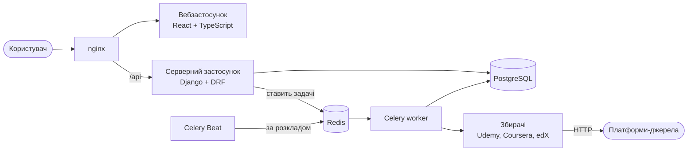

# Архітектура

Система реалізує монолітну архітектуру з фоновими воркерами, обрану в лабораторній роботі №2.
Цей документ коротко описує, як вона відображена в коді.

## Компоненти

| Компонент у документації | Де в репозиторії |
|---|---|
| Вебзастосунок (SPA) | `src/frontend` |
| Серверний застосунок | `src/backend/config`, `src/backend/apps` |
| Модуль «Облікові записи» | `src/backend/apps/accounts` |
| Модуль «Каталог і пошук» | `src/backend/apps/catalog` |
| Модуль «Керування збором» | `src/backend/apps/collection` |
| Модуль «Адміністрування» | `src/backend/apps/administration` |
| Модуль «Обране» | `src/backend/apps/favorites` |
| Воркер «Збирачі» | `src/backend/collectors` + задачі в `apps/collection/tasks.py` |
| Черга задач і планувальник | Redis, Celery, Celery Beat: застосунок Celery у `config/celery.py`, розклад `CELERY_BEAT_SCHEDULE` у `config/settings/base.py`, сервіси в `docker-compose.yml` |
| Розгортання | `docker-compose.yml`, `deploy/` |

## Потік збору даних

1. Celery Beat за розкладом (щодня о 03:00) запускає задачу `run_all_collections`, яка ставить
   у чергу `run_collection` для кожної зареєстрованої платформи; адміністратор може запустити
   `run_collection` для однієї платформи через `POST /api/admin/collection/{platform}/run/`.
2. Воркер створює `CollectionService`, який отримує збирач із реєстру за ідентифікатором платформи.
3. Збирач повертає потік записів `CourseDTO`.
4. `DjangoCourseRepository` створює або оновлює курси за парою «платформа та зовнішній
   ідентифікатор», тому дублікатів не виникає; для кожного курсу рахується відбиток нормалізованої
   назви. Якщо адміністратор відредагував курс, його назва, опис і категорія зберігаються під час
   наступних зборів, а решта полів оновлюється з джерела.
5. Курси платформи, яких більше немає в джерелі, позначаються недоступними.
6. Результат запуску (кількість нових, оновлених і недоступних курсів, помилка) зберігається в
   `ScrapeRun` і доступний адміністратору.

Збій одного збирача фіксується в журналі та не зупиняє збір з інших платформ. Запуск, у якому
збирач не повернув жодного курсу, вважається невдалим: він записується в журнал як помилка, а
курси платформи не позначаються недоступними (крок 5 пропускається).

Курси, приховані адміністратором, не показуються ні в каталозі, ні в обраному користувачів.

## Середовища

`docker-compose.yml` призначено лише для локальної розробки: стек працює з налаштуваннями
`config.settings.dev` (`DEBUG=True`, `ALLOWED_HOSTS=*`), а nginx доступний тільки на
`127.0.0.1:80`. У робочому середовищі використовуються налаштування `config.settings.prod`:
`DEBUG=False`, захищені cookie, обов'язкова змінна `DJANGO_SECRET_KEY`, схема запиту береться із
заголовка `X-Forwarded-Proto`, який nginx передає далі від балансувальника.

## Що ще не реалізовано

Каркас містить мінімальний функціонал. Наступні спринти додадуть реальні запити збирачів до
платформ (CH-16, CH-17, CH-24), порівняння курсів, сповіщення про зниження ціни, повноцінну форму
входу та решту функціональних і нефункціональних вимог зі специфікації.
