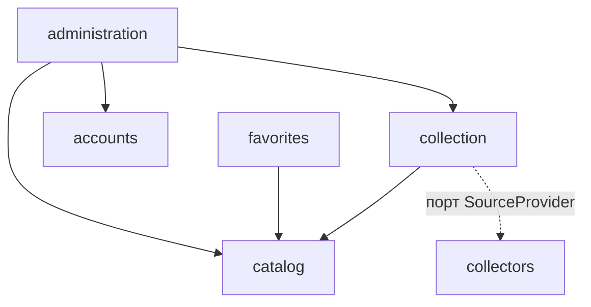

# Структура коду

## Принцип організації

Код поділено на модулі за відповідальністю. Один модуль відповідає одній предметній області й
має власні моделі, сервіси та API. Залежності спрямовані в один бік, від прикладних модулів до
загальних абстракцій.

Пунктирна лінія означає залежність від абстракції, а не від конкретного коду: застосунок
`collection` описує порти в `ports.py`, а пакет `collectors` реалізує їх. Імпорту `collectors`
у коді Django немає; реєстр збирачів підключається за шляхом із налаштування
`COLLECTION_SOURCES_FACTORY`.

## Серверна частина (`src/backend`)

| Модуль | Що містить |
|---|---|
| `config/` | налаштування за середовищами (`base`, `dev`, `prod`, `test`), кореневі маршрути, конфігурація Celery |
| `apps/accounts` | модель `User` (вхід за поштою, роль), реєстрація, профіль, JWT, право `IsAdminRole` |
| `apps/catalog` | моделі `Platform`, `Category`, `Course`; `CourseRepository` і його Django-реалізація; нормалізація назв та відбиток для пошуку дублікатів; пошук і фільтрація; REST API |
| `apps/collection` | `ScrapeRun` (журнал), порти `CourseSource` і `SourceProvider`, `CollectionService`, Celery-задачі |
| `apps/administration` | статистика, журнал запусків, ручний запуск збору, приховування й редагування курсів |
| `apps/favorites` | модель `Favorite` і API обраного |
| `collectors/` | `CourseDTO`, `CourseCollector`, `PagedJsonCollector`, збирачі Udemy, Coursera, edX, `Fetcher`, `CollectorRegistry` |

Кожен застосунок Django має типову будову: `models.py`, `serializers.py`, `views.py`, `urls.py`,
за потреби `services.py`, `repositories.py`, `permissions.py`, `tasks.py`.

## Вебзастосунок (`src/frontend/src`)

| Папка | Призначення |
|---|---|
| `api/` | `HttpClient`, `CourseApi` (інтерфейс) і `HttpCourseApi` (реалізація), контекст для підстановки реалізації |
| `components/` | `Layout`, `CourseCard`, `SearchBar`, `LanguageSwitcher` |
| `pages/` | `CatalogPage`, `CoursePage`, `LoginPage` (заглушка), `NotFoundPage` |
| `i18n/` | переклади українською та англійською, провайдер мови |
| `types/` | типи відповідей API |
| `test/` | налаштування та фікстури тестів |

## Тести

Структура `tests/` повторює структуру коду. Тести серверної частини використовують pytest-django
і SQLite в пам'яті. Тести збирачів не залежать від Django та мережі: замість HTTP вони
використовують підроблений `Fetcher`. Тести вебзастосунку лежать поруч із кодом у `src/frontend/src`
і запускаються через Vitest.
